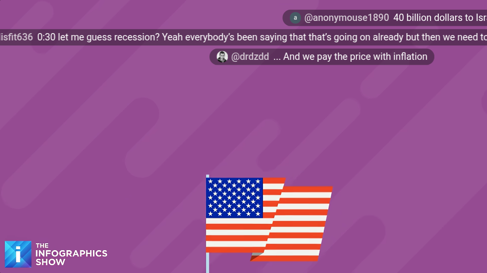
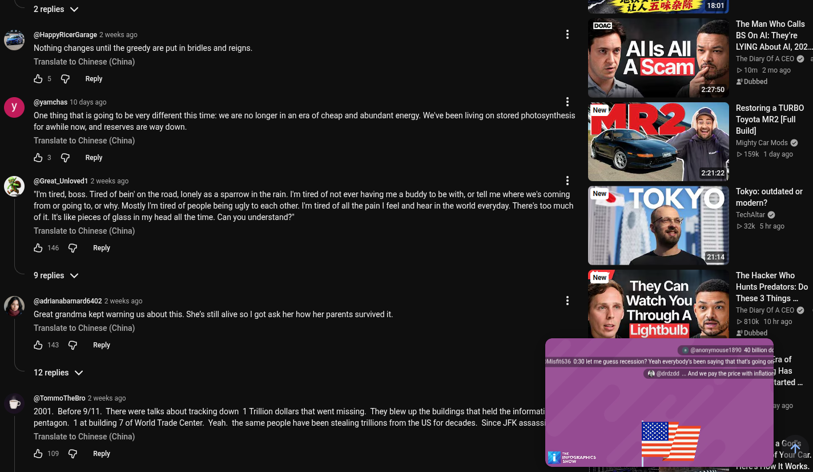

# YouTube+

A Chrome extension (MV3) with a few tools for YouTube. No API key: it uses the Google account already signed in to your browser.





## Features

- **TL;DR** — an icon on every thumbnail opens Gemini's key points and says whether the title is honest.
- **Comment danmaku** — comments appear over the video at the moment they talk about, as caption cards, flying lines or a side panel. Off by default.
- **Queue** — use one of your own playlists as the queue, so it survives tabs and devices; watched videos can be removed.
- **Player** — the watch-page player shrinks to a corner window as you scroll; the miniplayer gets controls, free dragging, minimize and a desktop pop-out; back-to-top and single-video loop.

Click the toolbar icon for settings. Each feature has its own switch, and the interface (English or Chinese) follows YouTube's language.

## Install

Tested with Node.js 22.

```sh
git clone https://github.com/nessusing/YouTube-plus.git
cd YouTube-plus
npm install
npm run build
```

Open `chrome://extensions`, turn on Developer mode, click **Load unpacked** and choose `.output/chrome-mv3`. Then refresh any open YouTube tabs.

TL;DR and AI-timed danmaku also need you to be signed in to [Gemini](https://gemini.google.com), with Gemini Apps Activity and the YouTube app turned on. TL;DR prepares summaries ahead of time; you can turn that off in settings.

## Ask your AI how to use it

Paste this into the AI assistant you already use:

> Read https://github.com/nessusing/YouTube-plus — the README first, then `docs/SPEC.md` and `docs/specs/` (written in Chinese). Then, in my language, help me install it and explain how to use each feature, one step at a time.

For development, point your coding agent at [AGENTS.md](AGENTS.md).

## License

[MIT](LICENSE)

## Disclaimer

Unofficial, and not affiliated with YouTube or Google. It relies on undocumented YouTube and Gemini web interfaces, which can break at any time and may put your account at risk. Use at your own risk.

Videos, thumbnails and comments shown in the screenshots belong to their respective owners and are not covered by the MIT license.
